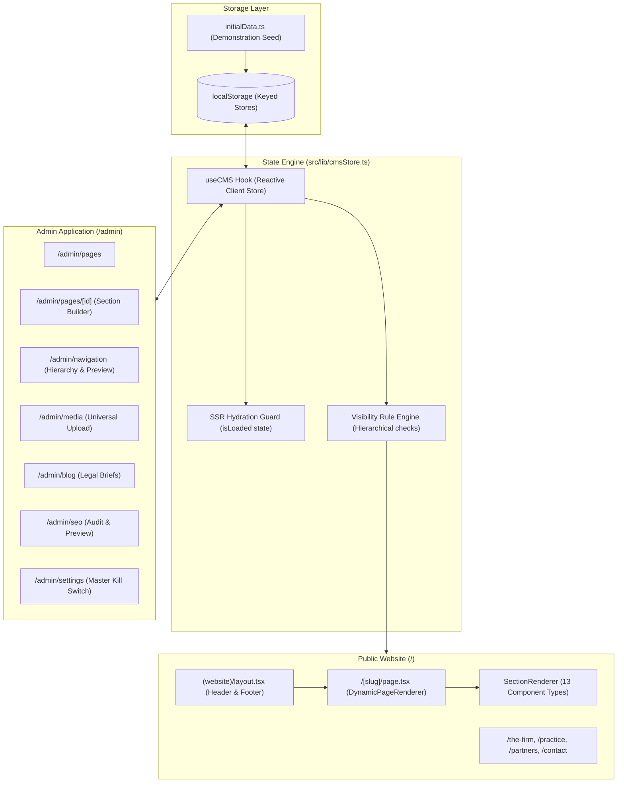
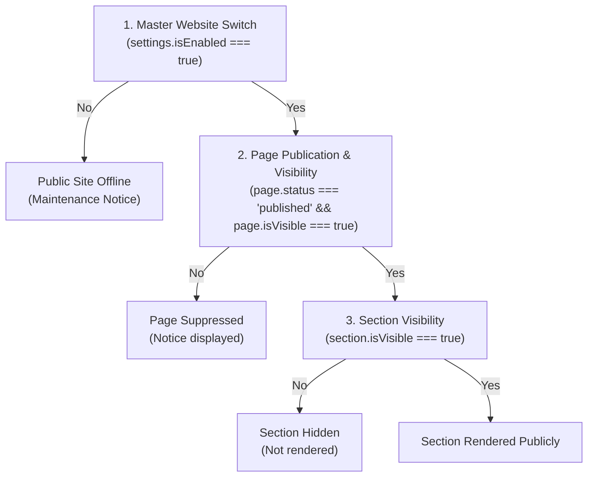
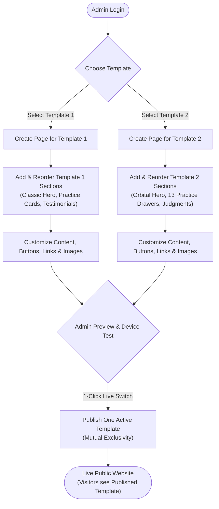
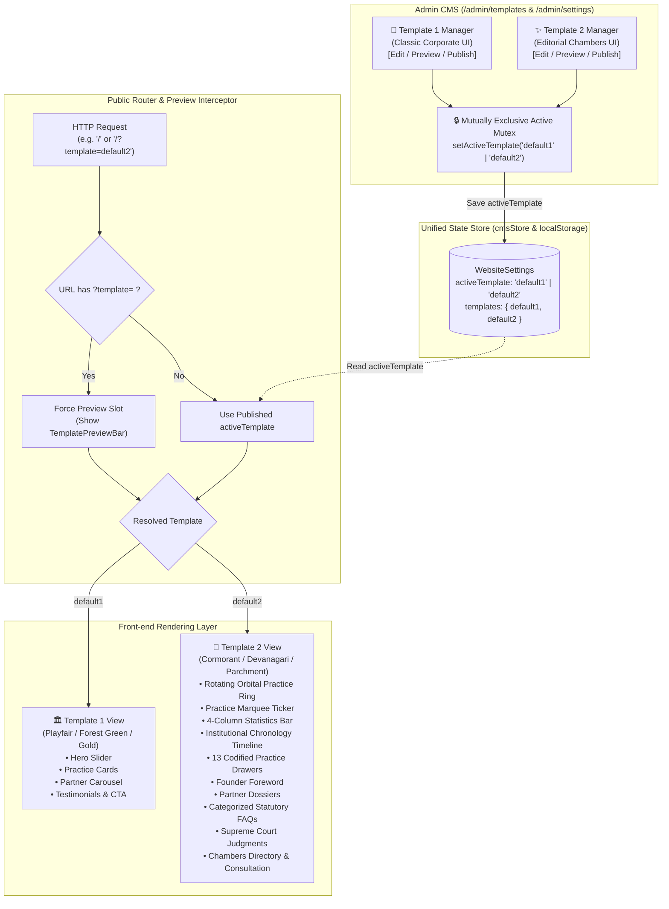

# Vanguard & Sterling LLP — Complete Implementation & Architecture Guide

A comprehensive, end-to-end technical reference and operational manual for the **Vanguard & Sterling LLP** Content Management System (CMS) and public website frontend.

---

## Table of Contents

1. [Executive Summary & Institutional Identity](#1-executive-summary--institutional-identity)
2. [Technology Stack & Core Architecture](#2-technology-stack--core-architecture)
3. [Reactive State Engine & Data Persistence](#3-reactive-state-engine--data-persistence)
4. [Complete Project & Directory Structure](#4-complete-project--directory-structure)
5. [Data Models Reference](#5-data-models-reference)
6. [Public Website Architecture & Dynamic Routing](#6-public-website-architecture--dynamic-routing)
7. [The 13 Standard Legal Section Types](#7-the-13-standard-legal-section-types)
8. [Admin CMS Dashboard — Comprehensive Route Reference](#8-admin-cms-dashboard--comprehensive-route-reference)
9. [The Modular Page Builder System](#9-the-modular-page-builder-system)
10. [Focused Collection Modals (Zero Form Clutter)](#10-focused-collection-modals-zero-form-clutter)
11. [Universal Image Upload & Media Management](#11-universal-image-upload--media-management)
12. [Navigation Management & Re-Parenting Engine](#12-navigation-management--re-parenting-engine)
13. [Hierarchical Visibility Rules (Rule Inheritance)](#13-hierarchical-visibility-rules-rule-inheritance)
14. [Input Placeholders vs. Edit Values Standard](#14-input-placeholders-vs-edit-values-standard)
15. [Step-by-Step Developer Workflows](#15-step-by-step-developer-workflows)
16. [Verification, Build, & Quality Assurance](#16-verification-build--quality-assurance)
17. [Multi-Template Architecture & Flow (Default 1 vs. Default 2)](#17-multi-template-architecture--flow-default-1-vs-default-2)

---

## 1. Executive Summary & Institutional Identity

### Domain Context
**Vanguard & Sterling LLP** is an elite law firm specializing in high-stakes corporate governance, cross-border M&A advisory, federal appellate litigation, and private wealth preservation. 

The website and CMS must reflect the gravitas, precision, and confidentiality expected of top-tier legal counsel.

### Visual Design Tokens
- **Primary Legal Palette**: Deep forest green (`#0e221b` / `legal-950`, `#1b3a2f` / `legal-800`) conveying institutional authority and longevity.
- **Polished Accent**: Warm satin gold (`#c5a880` / `gold-500`, `#dfcfb9` / `gold-300`) denoting prestige and distinction.
- **Law Stone Backgrounds**: Muted archival stone (`#fbfbfa`, `#f5f5f3`, `#ebeae6`) mimicking legal parchment and granite courthouses.
- **Typography**: Editorial serif headings (`font-serif`, Playfair Display / Cormorant style) paired with clean, highly readable neutral sans-serif body copy (`font-sans`, Inter style) and tabular monospace elements (`font-mono`) for statutory references, dates, and slugs.

---

## 2. Technology Stack & Core Architecture

| Layer | Technology | Role |
| :--- | :--- | :--- |
| **Framework** | Next.js 15+ (App Router, React 19) | Server-rendered shells with client-side interactive CMS islands. |
| **Language** | TypeScript (Strict Mode) | Strong typing, interfaces, and discriminated unions for section schemas. |
| **Styling** | Tailwind CSS v4 | Utility-first styling with custom legal color extensions. |
| **Icons** | Lucide React | Clean, minimalist iconography for controls, navigation, and indicators. |
| **State & Storage** | React Hooks + SSR-Safe `localStorage` | Reactive unified store providing immediate updates across public and admin views without backend dependencies. |
| **Routing** | App Router (`app/(website)` & `app/admin`) | Parallel route trees isolating public presentation from the administrative dashboard. |

### Architectural Flowchart



```
┌─────────────────────────────────────────────────────────────────────────────┐
│                            ARCHITECTURAL FLOW                               │
└─────────────────────────────────────────────────────────────────────────────┘
  [initialData.ts] ──► [localStorage] ◄──► [useCMS() Hook in cmsStore.ts]
                                                    │
                 ┌──────────────────────────────────┴──────────────────┐
                 ▼                                                     ▼
      [Admin Dashboard (/admin)]                         [Public Website (/)]
      • Pages & Section Builder                          • (website)/layout.tsx
      • Navigation Hierarchy                             • Catch-all [slug]/page.tsx
      • Media, Blog & SEO                                • Dynamic SectionRenderer
      • Master Switches                                  • Template 1 & 2 Renderers
```

---

## 3. Reactive State Engine & Data Persistence

All CMS data is managed via a single unified hook in `src/lib/cmsStore.ts`. It provides reactive state across all components and synchronizes with browser `localStorage`.

### 3.1 Storage Keys
The system partitions data into versioned keys to ensure clean isolation and support future migrations:
- `lawfirm_cms_pages_v4`: Pages array with all nested sections, content, and SEO metadata.
- `lawfirm_cms_menus_v1`: Navigation menus (Header, Footer) with nested item trees.
- `lawfirm_cms_blog_v1`: Legal insights and brief articles.
- `lawfirm_cms_media_v1`: Uploaded images, assets, dimensions, and usage tracking.
- `lawfirm_cms_forms_v1`: Matter intake forms and field definitions.
- `lawfirm_cms_buttons_v1`: Global call-to-action button configurations.
- `lawfirm_cms_sliders_v1`: Carousel and slider settings.
- `lawfirm_cms_content_v1`: Centralized reusable copy records.
- `lawfirm_cms_settings_v1`: Firm settings, contact registry, and master switch.

### 3.2 SSR Hydration Safety
To avoid React 19 hydration mismatches between server-rendered HTML and client `localStorage`:
1. The store initializes with defaults from `initialData.ts`.
2. A client-side `useEffect` reads `localStorage` upon mount.
3. An `isLoaded` flag is set to `true` once storage is synchronized.
4. UI components that depend on live storage observe `isLoaded` to prevent layout flashes.

### 3.3 Dynamic Schema Migration
`cmsStore.ts` contains automatic schema migration logic. When older data is read from `localStorage`, it ensures:
- The homepage features the **Senior Partners Card Carousel** and removes legacy showcase sections.
- Missing SEO fields (such as `robotsIndex` or `robotsFollow`) are automatically initialized with safe defaults (`true`).

---

## 4. Complete Project & Directory Structure

```
c:\Users\RemantaPaudelKhatri\Desktop\Projects\cms\
├── public/                         # Public static assets, logos, and firm badges
├── src/
│   ├── app/
│   │   ├── layout.tsx              # Root HTML document wrapper & font definitions
│   │   ├── globals.css             # Tailwind CSS imports & global resets
│   │   │
│   │   ├── (website)/              # Public-Facing Law Firm Website
│   │   │   ├── layout.tsx          # Public website wrapper (Header + Footer)
│   │   │   ├── page.tsx            # Homepage (renders page-home sections)
│   │   │   ├── [slug]/page.tsx     # Catch-all dynamic CMS page router
│   │   │   ├── the-firm/page.tsx   # Institutional heritage & founding principles
│   │   │   ├── practice/           # Practice areas directory
│   │   │   │   ├── page.tsx        # All practice areas
│   │   │   │   └── [slug]/page.tsx # Individual practice area profile
│   │   │   ├── partners/           # Senior leadership directory
│   │   │   │   ├── page.tsx        # Partner roster & search
│   │   │   │   └── [slug]/page.tsx # Full partner biography & court admissions
│   │   │   ├── questions/page.tsx  # Engagement FAQs & retention protocols
│   │   │   ├── foreword/page.tsx   # Annual institutional foreword
│   │   │   ├── contact/page.tsx    # Confidential matter submission registry
│   │   │   └── blog/               # Legal insights publications
│   │   │       ├── page.tsx        # Feed of articles with category filters
│   │   │       └── [slug]/page.tsx # Detailed legal analysis & brief
│   │   │
│   │   └── admin/                  # Secure Administration Dashboard
│   │       ├── layout.tsx          # Admin layout (Sidebar, top header, breadcrumbs)
│   │       ├── page.tsx            # Dashboard executive summary & activity log
│   │       ├── pages/              # Page Management & Builder
│   │       │   ├── page.tsx        # Pages table (search, template filter, duplicate, delete)
│   │       │   ├── create/page.tsx # New page wizard with 1-click navigation linking
│   │       │   └── [id]/page.tsx   # The Section Builder & Section Inspector
│   │       ├── sections/page.tsx   # Section library & shared vs page-specific overview
│   │       ├── navigation/page.tsx # Navigation menus, hierarchy, and simulation preview
│   │       ├── media/page.tsx      # Media library (upload, preview, delete, usage count)
│   │       ├── blog/               # Articles & legal insights management
│   │       │   ├── page.tsx        # Articles list
│   │       │   ├── create/page.tsx # Article authoring screen
│   │       │   └── [id]/page.tsx   # Article editing screen
│   │       ├── buttons/page.tsx    # Global CTA button configurations
│   │       ├── sliders/page.tsx    # Carousel & slider configurations
│   │       ├── forms/page.tsx      # Intake form builder & confidentiality notice
│   │       ├── content/page.tsx    # Centralized copy records & disclaimers
│   │       ├── seo/page.tsx        # Global SEO, OpenGraph, snippet preview, health audit
│   │       └── settings/page.tsx   # Firm metadata, branding, and master offline kill switch
│   │
│   ├── components/
│   │   ├── admin/
│   │   │   ├── page-builder/       # Modular Page Builder Architecture
│   │   │   │   ├── SectionList.tsx          # Order, visibility, actions & +Add Section
│   │   │   │   ├── SectionInspector.tsx     # 3-Tab inspector (Items, Content, Styling)
│   │   │   │   ├── SectionLibraryModal.tsx  # 13 pre-configured legal section templates
│   │   │   │   └── modals/                  # Focused collection item modals
│   │   │   │       ├── PartnerModal.tsx     # Partner biography & headshot uploader
│   │   │   │       ├── FaqModal.tsx         # FAQ Q&A accordion item
│   │   │   │       ├── PracticeModal.tsx    # Practice area discipline & summary
│   │   │   │       ├── TestimonialModal.tsx # Client accolade & executive quote
│   │   │   │       ├── StatisticModal.tsx   # Benchmark metric & sublabel
│   │   │   │       └── SlideModal.tsx       # Carousel slide with image & CTA
│   │   │   ├── navigation/
│   │   │   │   └── NavigationItemModal.tsx  # Link editor with placement & page sync
│   │   │   └── common/
│   │   │       ├── ImageUploadField.tsx     # Universal drag-and-drop / library uploader
│   │   │       ├── AdminBadge.tsx           # Status indicators
│   │   │       ├── AdminSwitch.tsx          # Toggle switches
│   │   │       └── ConfirmModal.tsx         # Deletion safety dialogs
│   │   │
│   │   └── website/
│   │       ├── layout/
│   │       │   ├── Header.tsx      # Public responsive navbar with nested dropdowns
│   │       │   └── Footer.tsx      # Institutional footer with legal disclaimers
│   │       ├── DynamicPageRenderer.tsx      # Section-driven page composer
│   │       └── sections/           # Public section renderers
│   │           ├── SectionRenderer.tsx      # Section type dispatcher & fallback
│   │           ├── HeroSection.tsx
│   │           ├── SliderSection.tsx
│   │           ├── RichTextSection.tsx
│   │           ├── IntroductionSection.tsx
│   │           ├── PracticeAreasSection.tsx
│   │           ├── PartnersSection.tsx
│   │           ├── TestimonialsSection.tsx
│   │           ├── FAQSection.tsx
│   │           ├── CTASection.tsx
│   │           ├── ContactSection.tsx
│   │           ├── LatestArticlesSection.tsx
│   │           ├── GallerySection.tsx
│   │           └── StatisticsSection.tsx
│   │
│   ├── types/
│   │   └── cms.ts                  # Discriminated union types and schemas
│   │
│   └── lib/
│       ├── cmsStore.ts             # Reactive store & visibility engine
│       ├── initialData.ts          # Default seed dataset for the firm
│       └── utils.ts                # Utilities (slugify, formatDate, cn)
│
├── IMPLEMENTATION.md               # This comprehensive implementation guide
├── README.md                       # High-level overview & quick-start manual
├── package.json                    # Dependencies & build scripts
├── tsconfig.json                   # Strict TypeScript compiler options
└── tailwind.config.ts              # Tailwind CSS configuration & legal colors
```

---

## 5. Data Models Reference

The CMS data models (defined in `src/types/cms.ts`) represent entities stored in `localStorage` and managed reactively via `cmsStore.ts`:

| Entity | Primary Identifiers | Key Properties | Purpose |
| :--- | :--- | :--- | :--- |
| **`Page`** | `id`, `slug` | `title`, `template`, `status`, `isVisible`, `sections`, `seo` | Top-level webpage containing an ordered list of sections. |
| **`PageSection`** | `id`, `type` | `name`, `order`, `isVisible`, `isReusable`, `content`, `settings` | Individual modular building block within a page. |
| **`SectionSettings`** | — | `backgroundColor`, `textColor`, `layout`, `spacing`, `containerWidth` | Visual presentation parameters per section. |
| **`NavigationMenu`** | `id`, `location` | `name`, `isVisible`, `items` (`NavigationItem[]`) | Header, footer, or secondary navigation trees. |
| **`WebsiteSettings`** | — | `firmName`, `activeTemplate`, `templates`, `isEnabled` | Global firm branding, active template, and kill switch. |
| **`BlogPost`** | `id`, `slug` | `title`, `content`, `excerpt`, `author`, `status`, `publishedAt` | Articles and legal briefs feed. |
| **`MediaItem`** | `id`, `url` | `name`, `type`, `size`, `alt`, `usedIn` | Universal uploaded assets library. |

---

## 6. Public Website Architecture & Dynamic Routing

### 6.1 Parallel Route Handlers
The public website uses Next.js App Router route groupings `(website)`. This ensures that public routes share the institutional Header and Footer while remaining cleanly separated from `/admin`.

### 6.2 The Dynamic Catch-All Router (`src/app/(website)/[slug]/page.tsx`)
When a user navigates to any URL:
1. Next.js checks for reserved static routes (`/the-firm`, `/practice`, `/partners`, `/contact`, `/blog`).
2. If none match, execution routes to `[slug]/page.tsx`.
3. `[slug]/page.tsx` invokes `<DynamicPageRenderer slug={params.slug} />`.
4. `DynamicPageRenderer` retrieves the page from `useCMS()`.
5. If the page does not exist, a styled 404 page is rendered with a link back to the homepage.
6. If the page is hidden or un-published, an informational notice is displayed.
7. If visible, sections are sorted by `order` and dispatched to `<SectionRenderer />`.

---

## 7. The 13 Standard Legal Section Types

Every page is constructed by assembling instances from this library of 13 pre-styled section components:

| # | Section Type (`type`) | Purpose & Features | Content Schema Key Fields |
| :- | :--- | :--- | :--- |
| **1** | `hero` | High-impact page header with headline, subheadline, background image, primary and secondary CTA buttons, and credibility metrics. | `headline`, `subheadline`, `description`, `primaryButtonLabel`, `primaryButtonUrl`, `imageUrl` |
| **2** | `partners` | Senior leadership card carousel or grid with headshots, credentials, admissions, direct dial, and confidential vCard links. | `title`, `description`, `items: PartnerData[]` |
| **3** | `practiceAreas` | Matrix of specialized legal disciplines with icon badges, slugs, and overview briefs. | `title`, `items: Array<{ title, slug, shortDescription }>` |
| **4** | `statistics` | Benchmark metrics (e.g., "48+ Years in Practice", "$40B+ Transaction Value") with labels and sublabels. | `items: Array<{ value, label, sublabel }>` |
| **5** | `faq` | Accordion FAQ addressing retention standards, conflict checks, and billing procedures. | `title`, `items: Array<{ question, answer, category }>` |
| **6** | `testimonials` | Client accolades, executive quotes, and courtroom testimonials with corporate titles. | `title`, `items: Array<{ quote, clientName, clientTitle, companyOrCase }>` |
| **7** | `slider` / `carousel` | Dynamic slide carousel with desktop/mobile images, headlines, overlay opacity, and CTA buttons. | `autoplay`, `interval`, `showArrows`, `showDots`, `slides: SlideItem[]` |
| **8** | `cta` | Institutional call-to-action banner with confidentiality disclosures. | `title`, `description`, `primaryButtonLabel`, `primaryButtonUrl`, `confidentialityNote` |
| **9** | `introduction` | Founding creed, managing partner signature, and firm overview with accompanying imagery. | `eyebrow`, `title`, `paragraphs: string[]`, `imageUrl`, `signatureName`, `signatureRole` |
| **10** | `contact` | Manhattan registry address, telephone lines, and confidential matter intake form. | `title`, `address`, `phone`, `email`, `officeHours` |
| **11** | `richText` | Unstructured editorial body supporting HTML headings, quotes, statutory references, and prose. | `title`, `htmlContent: string` |
| **12** | `latestArticles` | Dynamic feed showcasing recent legal insights and scholarly publications. | `title`, `count: number`, `categoryFilter`, `viewAllUrl` |
| **13** | `gallery` | High-resolution photography of firm headquarters, library archives, and conference chambers. | `title`, `images: Array<{ url, alt, caption }>` |

---

## 8. Admin CMS Dashboard — Comprehensive Route Reference

The `/admin` dashboard provides administrative control across the firm's web presence:

### 8.1 `/admin` (Executive Overview)
- **Metrics Bar**: Total configured pages, published legal articles, media assets, and active navigation menus.
- **Quick Actions**: One-click shortcuts to *Create New Page*, *Write Legal Brief*, *Upload Media*, and *Configure Navigation*.
- **Recent System Activity**: Audit trail of recent page modifications, additions, and publication state changes.

### 8.2 `/admin/pages` (Page Directory)
- **Search & Filter Toolbar**: Search pages by title or slug; filter by template or publication status (`draft`, `published`, `archived`).
- **Comprehensive Table**: Displays Title, Slug, Template, Section Count, Publication Status, Visibility toggle, and Last Modified timestamp.
- **Actions**:
  - **Edit**: Direct link to the Section Builder (`/admin/pages/[id]`).
  - **Duplicate**: Clones the page, its sections, and settings with a single click.
  - **Delete**: Protected by a confirmation dialog with warning.

### 8.3 `/admin/pages/create` (Page Creation Wizard)
- **Details Card**: Page Title, URL Slug (auto-generated using `slugify()`, or customizable), and Internal Editorial Description.
- **Navigation Integration**: Optional **`[✓] Also add this page to Header Navigation Menu`** checkbox. When selected, automatically appends a link to the primary header menu.
- **Template Selection Grid**: Choose from 6 pre-assembled legal starting templates:
  - *Landing Page*: Institutional hero, statistics, practice areas, partner highlights, and CTA.
  - *Standard Content*: Hero header followed by rich editorial text.
  - *Practice Area Listing*: Practice directory with discipline cards.
  - *Partner Directory*: Partner listing with biographical cards.
  - *Contact & Consultation*: Registry details and intake form.
  - *Frequently Asked Questions*: Accordion Q&A.
- Submitting redirects directly to the Section Builder.

### 8.4 `/admin/pages/[id]` (Section Builder & Inspector)
*Detailed in Section 9.*

### 8.5 `/admin/sections` (Section Library & Reusable Records)
- Central catalog listing every section across every page.
- Distinguishes **Shared (Global)** sections from **Page-Specific** sections.
- Provides an **"Edit in Page"** deep-link button that routes directly to `/admin/pages/[pageId]?sectionId=[sectionId]`.

### 8.6 `/admin/navigation` (Navigation Hierarchy & Simulation)
*Detailed in Section 12.*

### 8.7 `/admin/media` (Universal Media Library)
*Detailed in Section 11.*

### 8.8 `/admin/blog`, `/admin/blog/create`, `/admin/blog/[id]` (Legal Insights)
- Authoring environment for legal briefs, articles, and white papers.
- Supports category classification, tags, featured images, and rich HTML formatting.
- Dedicated SEO tab for custom article search meta and canonical tags.

### 8.9 `/admin/seo` (Global SEO & Search Console Simulation)
- Global defaults for meta titles, descriptions, and OpenGraph social share cards.
- **Google Search Snippet Simulation**: Previews how the firm's website appears on desktop and mobile Google Search results.
- **Automated Health Check**: Evaluates title lengths, meta descriptions, and robots directives.

### 8.10 `/admin/settings` (Firm Settings & Master Switch)
- **Master Website Switch**: Global toggle to immediately take the public site offline into maintenance mode.
- Firm headquarters address, direct telephone lines, and confidential email registry.
- Feature module switches (Blog, Forms, Testimonials, Sliders).

---

## 9. The Modular Page Builder System

Located at `/admin/pages/[id]`, the Page Builder is designed for clarity and ease of use:

```
┌────────────────────────────────────────────────────────────────────────┐
│ Top Bar: Title | Status Badge | Visibility Toggle | Live Link | Actions│
├─────────────────────────┬──────────────────────────────────────────────┤
│ Left Pane (Col 4)       │ Right Pane (Col 8)                           │
│ SectionList             │ SectionInspector                             │
│                         │ ┌──────────────────────────────────────────┐ │
│ • 1. Hero Header   [↑↓] │ │ Tabs: [Items] | [Copy] | [Styling]       │ │
│ • 2. Practice Grid [↑↓] │ ├──────────────────────────────────────────┤ │
│ • 3. Senior Partners[↑↓]│ │ Tab Content                              │ │
│ • 4. Action Banner [↑↓] │ │ (Modals handle add/edit; no inline forms)│ │
│                         │ └──────────────────────────────────────────┘ │
│ [+ Add Section Button]  │ Live Visual Preview of Active Section        │
└─────────────────────────┴──────────────────────────────────────────────┘
```

### Component Breakdown
1. **`SectionList.tsx`**:
   - Manages the vertical order of sections.
   - Includes $\uparrow$ and $\downarrow$ buttons to reorder with immediate live updates.
   - Includes an Eye toggle to show/hide sections without deletion.
   - Includes Duplicate and Delete actions.
   - Includes a **`+ Add Section`** button that opens `SectionLibraryModal.tsx`.
2. **`SectionInspector.tsx`**:
   - Provides a 3-tab inspector:
     - **Collection Items**: Active for collection sections (partners, FAQs, practices, testimonials, stats, slides). Displays clean cards with reorder, edit, and delete buttons, plus an **`+ Add [Item]`** button that launches the appropriate modal.
     - **Headings & Copy**: Edit headlines, subheadlines, descriptions, and CTA labels.
     - **Layout & Styling**: Configure container width, padding, background colors, and layout variants.
   - Manages the **Shared vs. Page-Specific** (`isReusable`) toggle with a visual warning when editing shared components.
3. **`SectionLibraryModal.tsx`**:
   - Clean modal showcasing all 13 legal component types with icons and descriptions for one-click insertion.

---

## 10. Focused Collection Modals (Zero Form Clutter)

To prevent visual clutter, collection sections delegate item creation and editing to dedicated modals:

```
src/components/admin/page-builder/modals/
├── PartnerModal.tsx      # Partner headshot, name, role, email, phone, bio
├── FaqModal.tsx          # FAQ question, answer, category
├── PracticeModal.tsx     # Practice discipline title, slug, short description
├── TestimonialModal.tsx  # Quote, client name, executive title, company/matter
├── StatisticModal.tsx    # Metric value, label, sublabel
└── SlideModal.tsx        # Slide title, subtitle, desktop image, CTA link
```

### Operational Rules for All Modals
- **Add Mode**:
  - All form fields initialize empty (`''`).
  - Inputs display realistic, descriptive placeholders (e.g., `placeholder="e.g. Senior Managing Partner"`).
  - No dummy data is pre-filled into fields.
- **Edit Mode**:
  - Fields are bound to the actual saved record (`value={data.field ?? ''}`).
  - Placeholders are only visible if a field was previously left blank.
- **Validation**:
  - Required fields are enforced.
  - Slugs are auto-formatted (lowercase, hyphenated, special characters stripped).

---

## 11. Universal Image Upload & Media Management

Image uploads across the CMS (partner headshots, carousel slides, hero banners, SEO cards, blog featured images) use the unified `<ImageUploadField />` component (`src/components/admin/common/ImageUploadField.tsx`).

### Three Upload Modes Supported
1. **Local File Drag-and-Drop / Browse**:
   - Accepts image files via drag-and-drop or file picker.
   - Reads the file via browser `FileReader` and converts it into an optimized Base64 data URL.
   - Automatically registers the asset in the **Media Library** (`/admin/media`) with filename, dimensions, file size, and timestamp.
2. **Media Library Chooser**:
   - A **"Choose from Media Library"** button opens a modal grid of all previously uploaded assets.
   - Selecting any asset immediately populates the field and associates the image.
3. **External URL Fallback**:
   - Allows direct input of external web URLs (e.g., Unsplash or firm CDN links).

---

## 12. Navigation Management & Re-Parenting Engine

The Navigation Manager at `/admin/navigation` manages website menus with full hierarchy and re-parenting support:

### 12.1 Menu Hierarchy & Re-Parenting
The link editor (`NavigationItemModal.tsx`) includes a **Menu Placement** selector:
- **Top-Level Link**: Places the link on the primary navigation bar.
- **Sub-Item under [Parent Link]**: Nests the link inside an existing parent item's dropdown menu.
- Changing placement automatically updates the menu tree, removing the item from its previous position and inserting it into the new location.

### 12.2 Automatic Page Synchronization
When **"Existing CMS Page"** is selected as the destination type:
- Selecting a page from the dropdown automatically populates the link label with that page's title (if the label is currently empty or matches a previous page).
- Sets the URL destination to `/${page.slug}`.

### 12.3 Sub-Item Actions
Every child link within a dropdown menu supports:
- **Move Up / Move Down**: Reorder sub-items within their parent dropdown.
- **Visibility Toggle**: Independently show or hide a sub-item.
- **Edit**: Re-opens `NavigationItemModal` to edit labels, URLs, or placement.
- **Delete**: Removes the sub-item with confirmation.

### 12.4 Real-Time Simulation Preview
A live preview panel simulates navigation behavior:
- **Desktop View**: Shows horizontal menu layout with dropdown indicators.
- **Mobile View**: Simulates mobile hamburger navigation.

---

## 13. Hierarchical Visibility Rules (Rule Inheritance)

The visibility of content on the public website is governed by strict inheritance rules implemented in `cmsStore.ts`:



### Rules Summary
1. **Master Switch**: If the global site switch in `Settings` is disabled, the entire public site displays an institutional maintenance notice.
2. **Page Status**: A page renders publicly only if its status is `published` AND `isVisible` is `true`.
3. **Section Visibility**: A section renders only if its parent page is visible AND the section's `isVisible` is `true`.
4. **Navigation Visibility**: A navigation link renders only if its menu is active, the link itself is visible, and **all ancestor parent links are visible**. Hiding a parent link automatically suppresses all of its child dropdown items.
5. **No Data Loss**: Hiding content never deletes it. It can be re-enabled at any time with a single click.

---

## 14. Input Placeholders vs. Edit Values Standard

To maintain clean and intuitive forms across the entire CMS, all input fields follow this standard:

| Scenario | Input Value Binding | Placeholder Behavior | Example |
| :--- | :--- | :--- | :--- |
| **Add / Create Mode** | `value=""` (empty string) | Descriptive, realistic legal example | `placeholder="e.g. Senior Managing Partner"` |
| **Edit Mode (value exists)** | `value={data.field}` | Hidden beneath populated value | Input displays `"Eleanor Vance, QC"` |
| **Edit Mode (value empty)** | `value=""` | Descriptive placeholder displayed | `placeholder="e.g. appellate-litigation"` |

Form fields are never pre-filled with dummy text (such as "New Link" or "Partner Name") that the user has to manually delete before typing.

---

## 15. Step-by-Step Developer Workflows

### 15.1 How to Create a New Page and Add It to Navigation
1. Go to `/admin/pages/create`.
2. Enter the **Page Title** (e.g., `"Appellate Litigation Brief"`).
3. The URL slug automatically populates as `appellate-litigation`.
4. Check **`[✓] Also add this page to Header Navigation Menu`**.
5. Select a starting template (e.g., *Landing Page*).
6. Click **"Create Page & Open Section Builder"**.
7. In the Section Builder, customize headlines, add partners or FAQs via modals, and reorder sections.
8. Set the page status to **"Published"** and toggle visibility to **"Visible"**.
9. The page is immediately accessible at `/appellate-litigation` and appears in the website header.

### 15.2 How to Add a New Section to an Existing Page
1. Open `/admin/pages/[id]`.
2. In the left-hand **Section Hierarchy** panel, click **"+ Add Section"**.
3. In the modal, browse the 13 available section types and click **"+ Add Section"** on the desired type.
4. The section is appended to the bottom of the page.
5. Use the $\uparrow$ button to move it to the desired position.
6. Select the section to open the **Section Inspector** on the right, where you can configure its copy, items, and styling.

### 15.3 How to Add a Dropdown Sub-Menu Link
1. Go to `/admin/navigation`.
2. Click **"+ Add Menu Link"**.
3. In the modal, set **Menu Placement** to `↳ Sub-item under: "[Parent Name]"`.
4. Set **Destination Type** to `CMS Page` and select the target page from the dropdown.
5. The link label automatically fills with the page title.
6. Click **"Add Link to Menu"**.
7. The new link appears indented under its parent in the menu tree.

### 15.4 How to Add a New Section Component to the System
To add a new section type (e.g., `awards`):
1. **Update Types**: In `src/types/cms.ts`, add `'awards'` to `SectionType` and define an `AwardsSectionContent` interface.
2. **Add Public Renderer**: In `src/components/website/sections/AwardsSection.tsx`, implement the public-facing UI component.
3. **Register Renderer**: In `src/components/website/sections/SectionRenderer.tsx`, add `awards: AwardsSection` to `sectionRegistry`.
4. **Update Section Library**: In `src/components/admin/page-builder/SectionLibraryModal.tsx`, add a template card with default content for `awards`.
5. **Update Inspector**: In `src/components/admin/page-builder/SectionInspector.tsx`, add custom fields under the *Headings & Copy* tab for the new section type.

---

## 16. Verification, Build, & Quality Assurance

### Quality Assurance Checklist
- [x] **0 TypeScript Errors**: Verified with `npx tsc --noEmit`.
- [x] **SSR-Safe**: No hydration mismatch errors on page reload.
- [x] **Persistence Verified**: All changes made in `/admin` persist across browser reloads via `localStorage`.
- [x] **Hierarchical Visibility**: Verified that hiding an ancestor menu or section suppresses descendants correctly.
- [x] **Image Upload System**: Verified drag-and-drop, Media Library selection, and external URL fallback.
- [x] **Clean Form States**: Verified that add modes start empty with realistic placeholders and edit modes display saved values.

### Build Commands
```bash
# Verify TypeScript types
npx tsc --noEmit

# Run local development server
npm run dev

# Build production bundle
npm run build

# Start production server
npm start
```

---

## 17. Multi-Template Architecture & Flow (Default 1 vs. Default 2)

### 17.1 Architecture Overview
The platform incorporates a **Dual-Template Engine** allowing administrators to maintain, customize, and preview two radically distinct architectural user interfaces:
1. **Template 1 (`default1`)**: Classic Corporate Legal UI (*Vanguard & Sterling LLP*), featuring full-bleed hero sliders, 6-block practice area grids, senior partner carousels, and modular dynamic section builders.
2. **Template 2 (`default2`)**: Editorial Research Chambers UI (*Law Chambers & Legal Research, Kathmandu*), featuring a scholarly ivory/parchment palette (`#F7F6F2`), an animated 5-slot orbital practice area ring, a horizontal continuous marquee ticker, an institutional chronology timeline (2055–2080 B.S.), 13 codified Nepali statutory practice drawers, Supreme Court of Nepal reported judgments index, and categorized statutory guidance FAQs.

### 17.2 Simple Multi-Admin Template Workflow Flowchart



```
┌─────────────────────────────────────────────────────────────────────────────┐
│                    SIMPLE TEMPLATE WORKFLOW                                 │
└─────────────────────────────────────────────────────────────────────────────┘
  [1. Select Template] ────► Choose Template 1 (Classic) or Template 2 (Editorial)
           │
           ▼
  [2. Create Page]     ────► Enter Page Title & URL slug (e.g. /practice, /about)
           │
           ▼
  [3. Add Sections]    ────► Choose sections tailored to the template & reorder
           │
           ▼
  [4. Edit Content]    ────► Customize headings, text, buttons, links, images
           │
           ▼
  [5. Publish Live]    ────► Activate template (Mutex: 1 live at a time)
```

### 17.3 System Architecture Diagram



### 17.4 Core Architectural Guarantees

#### 1. Mutual Exclusivity (Single Published Template at a Time)
* The active template is governed by `settings.activeTemplate` (`'default1' | 'default2'`).
* When an administrator clicks **"Publish (Make Active)"** for Template 2, `activeTemplate` is atomically set to `'default2'`.
* Template 1 automatically becomes inactive (standby draft). Its layout, configuration, and data are preserved intact without data loss or interference.

#### 2. Non-Destructive Independent Customization
* Admin can customize copy, images, and section parameters for Template 1 and Template 2 independently.
* Customizing Template 2 will never overwrite or disrupt Template 1's sections or layout.

#### 3. Real-Time Admin Preview Mode
* Any template (even while in draft/inactive standby) can be previewed live at:
  * `/?template=default1`
  * `/?template=default2`
* When a preview query parameter is detected:
  1. The page renders the requested template regardless of which is currently published.
  2. The **`TemplatePreviewBar`** sticky banner appears at the top, notifying the admin that they are in preview mode.
  3. The banner provides a one-click **"Publish This Template Live"** button to promote the draft template to production immediately.
  4. An **"Exit Preview"** button returns the user to the currently published live site.

#### 4. Integrated Device Viewport Simulation
* In `/admin/templates`, administrators have an embedded viewport simulator:
  * **Desktop**: Full responsive width.
  * **Tablet**: Simulated 768px tablet container.
  * **Mobile**: Simulated 375px mobile device viewport.
* Admins can verify responsive typography, orbital card scaling, and drawer collapsing before publishing.

### 17.5 File & Component Mapping

| Component | Path | Description |
| :--- | :--- | :--- |
| **Data Repository** | `src/data/firmData.ts` | Complete static data model for Template 2 (all 13 practice areas, firm profile, milestones, judgments, partners, FAQs). |
| **Template 2 Root** | `src/components/templates/default2/Template2View.tsx` | Master view assembling all Template 2 sections and editorial header/footer. |
| **Orbital Hero** | `src/components/templates/default2/HeroSection.tsx` | Interactive 5-card orbiting practice area wheel with auto-cycling cards and Nepali watermark. |
| **Practice Drawers** | `src/components/templates/default2/PracticeAreasSection.tsx` | 13 codified practice areas with bilingual titles, statutory citations, and expandable drawers. |
| **Milestones Timeline** | `src/components/templates/default2/FirmOverviewSection.tsx` | Vertical chronology timeline from 2055 B.S. (1998) to 2080 B.S. (2023). |
| **Statutory FAQ** | `src/components/templates/default2/FaqSection.tsx` | Tabbed subject filter with expandable questions and statutory citations. |
| **Judgments Record** | `src/components/templates/default2/SelectedJudgmentsSection.tsx` | Nepal Kanoon Patrika (NKP) reported Supreme Court decisions. |
| **Template 1 Root** | `src/components/templates/default1/Template1View.tsx` | Classic Vanguard & Sterling corporate layout. |
| **Preview Bar** | `src/components/website/TemplatePreviewBar.tsx` | Sticky client preview banner with one-click publish action. |
| **Template Admin** | `src/app/admin/templates/page.tsx` | Dedicated dashboard for comparing, previewing, and publishing templates. |
| **Settings Integration** | `src/app/admin/settings/page.tsx` | Radio-group selector for published UI template. |

